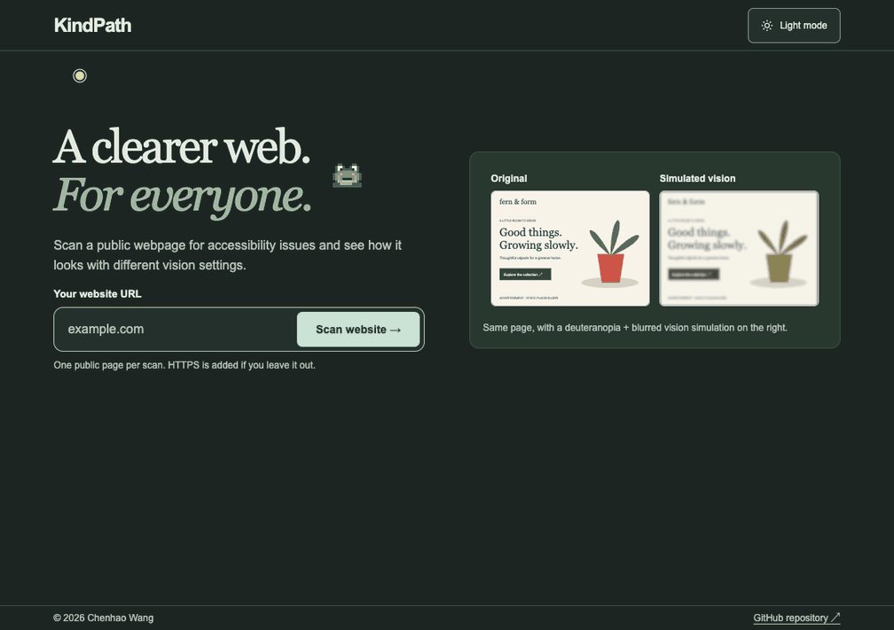

# KindPath

KindPath runs locally and uses an isolated Chromium browser to check one public webpage for accessibility issues. It returns a downloadable JSON report and, when capture succeeds, a JPEG preview from the same scan.



## Run locally

Install Git and Node.js 22.12 or later. Start Docker on a supported setup:

- **macOS:** Docker Desktop installed at `/Applications/Docker.app`.
- **Linux:** Docker Engine with Buildx, the CLI at `/usr/bin/docker`, and access to `/var/run/docker.sock` from your user account.

Clone the repository, install dependencies, and start KindPath:

```sh
git clone https://github.com/implexrr/KindPath.git
cd KindPath
npm ci
npm run dev
```

Wait for both Vite and the local API to report that they’re ready, then open [KindPath](http://127.0.0.1:5173/). The first startup downloads packages and builds the scanner images. Scanning and capture are enabled by default.

## Scan a page

1. Enter `https://example.com/` or another public URL, then select **Scan website**. If you omit the scheme, KindPath uses HTTPS.
2. Select **View report** to inspect findings and filter them by severity. Select **Download report JSON** to save the report.
3. Select **Visual preview** to compare the original capture with an educational vision simulation. Use **Fit width** or **Actual size** to inspect the image. Links and forms in the preview are inactive.

KindPath scans only the final page after allowed redirects and records both the submitted and final URLs. Reports disclose coverage limits and capture failures. Automated checks require manual follow-up to assess accessibility conformance. Reloading clears the report from browser memory. KindPath requires no account or database.

## Checks

```sh
npm test
npm run build
npm run build:production
```

See the [CI workflow](.github/workflows/ci.yml) for the scanner and browser integration checks.

See the [scanner notices](scanner/NOTICE.md) and [codec documentation](scanner/codec/README.md) for third-party attribution and patch details.

Report bugs in [GitHub Issues](https://github.com/implexrr/KindPath/issues).
